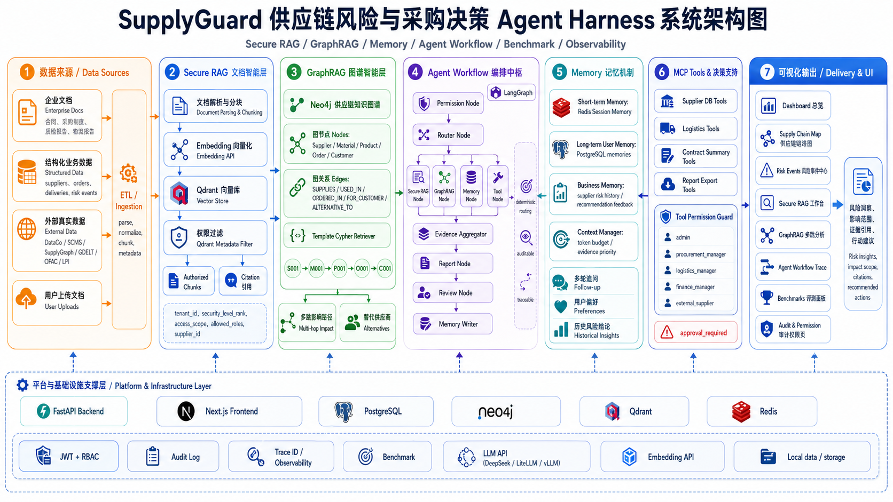

# SupplyGuard

面向供应链风险管理与采购决策的工程化 **Agent Harness 平台**——在 RBAC 权限约束下，融合 Secure RAG、GraphRAG、Memory 与 LangGraph 多 Agent 工作流，为采购、物流、质量、财务与高管提供 **可审计、可引用、可评估** 的风险洞察与决策支持。

## 系统架构



上图展示了 SupplyGuard 的七层能力模块与底层基础设施。整体采用 **Monorepo** 结构（`apps/` + `packages/`），前后端分离，数据层多存储协同。

### 架构分层说明

| 模块 | 职责 | 关键技术 |
|------|------|----------|
| **数据来源** | 企业文档、结构化业务数据、外部开源数据集、用户上传；经 ETL 解析、标准化、分块 | `packages/data_adapters/` |
| **Secure RAG** | 文档智能检索；在 Qdrant 层做 tenant + 密级 + 角色/供应商 scope 过滤 | Qdrant、Embedding API |
| **GraphRAG** | 供应链知识图谱多跳推理；预置 Cypher 模板（非 Text2Cypher） | Neo4j |
| **Agent 编排** | LangGraph 10 节点固定工作流；规则路由 + 证据聚合 + 报告生成 + 审查 | LangGraph、DeepSeek |
| **Memory** | Redis 短期会话记忆 + PostgreSQL 长期记忆；支持多轮追问 | Redis、PostgreSQL |
| **MCP Tools** | 供应商/物流/报告导出等结构化工具；角色白名单 + 高风险审批 | `packages/mcp_servers/` |
| **可视化输出** | Next.js 控制台：Dashboard、RAG/GraphRAG 工作台、Agent Trace、Benchmark | Next.js 15、ECharts、React Flow |
| **基础设施** | JWT + RBAC、Audit Log、trace_id 全链路可观测、确定性 Benchmark | FastAPI、Docker Compose |

### 与普通 RAG Demo 的区别

- **权限在检索层**：Filter 在 Qdrant / Neo4j / Tool 入口执行，而非 Prompt 自律
- **Harness 而非 Autonomous Agent**：固定工作流 + 权限护栏，规则路由替代 LLM 自主规划
- **多源证据**：文档向量 + 图谱路径 + 记忆 + 结构化 Tool，统一聚合后生成报告
- **可观测与评测**：每次请求绑定 `trace_id`；111 条 Benchmark 覆盖 RAG / Graph / Memory / 权限边界

---

## 核心流程

### 1. Chat 主路径（`POST /api/v1/chat`）

LangGraph Agent 工作流的完整链路：

```
Permission → Router → [Tool | GraphRAG | RAG | Memory]*
  → Aggregator → Report → Review → Memory Writer
```

| 节点 | 作用 |
|------|------|
| `permission` | 查询级权限检查；拒绝则跳转 review |
| `router` | **规则路由**（关键词 + 实体码），非 LLM 规划 |
| `tool` / `graphrag` / `rag` / `memory` | 按场景调用 MCP 工具、图谱检索、文档 RAG、记忆检索 |
| `aggregator` | 多源证据合并、去重、上下文预算裁剪 |
| `report` | LLM 生成结构化报告 + citations |
| `review` | 规则审查（引用存在性、blocked 处理） |
| `memory_writer` | 写入会话/长期记忆 |

**路由模式：** `rag` · `graphrag` · `hybrid` · `memory_rag` · `tool` · `memory`

### 2. Secure RAG 路径（`POST /api/v1/rag/query`）

```
JWT 认证 → build_qdrant_permission_filter(user_context)
  → embed(query) → Qdrant Top-K（Cosine，MVP 无 Rerank）
  → PostgreSQL 加载 chunk 正文 → LLM 生成 + citations
```

Qdrant payload 含 `tenant_id`、`security_level_rank`、`access_scope`、`allowed_roles`、`supplier_id` 等，**检索前过滤**，非检索后裁剪。

### 3. GraphRAG 路径（`POST /api/v1/graphrag/query`）

```
JWT → 角色 query_type 权限检查 → 选择 Cypher 模板
  → Neo4j 多跳查询 → 路径解析 → 返回影响链
```

**图谱节点：** Supplier · Material · Product · Order · Customer · RiskEvent · DeliveryEvent · QualityIssue

**典型路径：** `Supplier → Material → Product → Order → Customer`

**Cypher 模板：** supplier_impact · product_dependency · supplier_alternatives · delivery_delay_impact · quality_issue_trace · customer_order_dependency 等

### 4. 文档入库（`POST /api/v1/documents/upload`）

```
上传 txt/md/pdf → data/raw/ → 解析分块 → Embedding
  → Qdrant upsert + PostgreSQL documents/chunks 双写（含权限 metadata）
  → 解析文本落盘 data/processed/
```

---

## 技术栈

**后端：** Python 3.11 · FastAPI · LangGraph · SQLAlchemy · Alembic  
**前端：** Next.js 15 · React 19 · TypeScript · Tailwind · Zustand · React Query  
**存储：** PostgreSQL · Qdrant · Neo4j · Redis · 本地 `data/`（MinIO 预留）  
**AI：** DeepSeek / LiteLLM / vLLM（LLM）· SiliconFlow 等（Embedding）  
**部署：** Docker Compose · uv 包管理

---

## 环境要求

- Python >= 3.11，[uv](https://github.com/astral-sh/uv)
- Node.js 18+（前端）
- Docker Compose（Postgres / Redis / Qdrant / Neo4j / MinIO）
- 复制 `.env.example` 为 `.env`，填入 `DEEPSEEK_API_KEY`、`EMBEDDING_*`、`JWT_SECRET_KEY`、`EMBEDDING_DIM`

---

## 快速开始

```bash
git clone https://github.com/betterzyq/SupplyGuard.git
cd SupplyGuard

uv sync
cp .env.example .env          # 填入 API Key

make up                       # 启动 Docker 基础设施
make migrate
make seed
make ingest-seed-docs
make build-graph

make api                      # 终端 1：FastAPI :8000
make web-install && make web  # 终端 2：Next.js :3000
```

**冒烟测试：**

```bash
make smoke-mvp3               # Secure RAG
make smoke-graphrag           # GraphRAG
make smoke-benchmark          # Benchmark
```

**Demo 账号：** `admin@example.com` / `password123`（仅开发环境）

---

## API 示例

### 登录

```bash
curl -X POST http://localhost:8000/api/v1/auth/login \
  -H "Content-Type: application/json" \
  -d '{"email":"admin@example.com","password":"password123"}'
```

### Secure RAG

```bash
curl -X POST http://localhost:8000/api/v1/rag/query \
  -H "Authorization: Bearer $TOKEN" \
  -H "Content-Type: application/json" \
  -d '{"query":"Alpha Components 合同付款条款是什么？","top_k":5}'
```

### GraphRAG

```bash
curl -X POST http://localhost:8000/api/v1/graphrag/query \
  -H "Authorization: Bearer $TOKEN" \
  -H "Content-Type: application/json" \
  -d '{
    "query": "供应商 SUP-001 延迟会影响哪些订单和客户？",
    "query_type": "supplier_impact",
    "entity_code": "SUP-001",
    "top_k": 20
  }'
```

### Chat（LangGraph 完整工作流）

```bash
curl -X POST http://localhost:8000/api/v1/chat \
  -H "Authorization: Bearer $TOKEN" \
  -H "Content-Type: application/json" \
  -d '{"query":"请总结 Alpha Components 合同中的付款条款。"}'
```

返回包含 `answer`、`citations`、`trace_id`、`nodes_executed`、`graph_paths`。

---

## 项目结构

```
SupplyGuard/
├── apps/
│   ├── api/              # FastAPI 入口、路由、中间件
│   └── web/              # Next.js 前端控制台
├── packages/
│   ├── agents/           # LangGraph 工作流（10 节点）
│   ├── rag/              # 文档摄取、Secure RAG
│   ├── graphrag/         # Neo4j 模板 Cypher、建图
│   ├── memory/           # Redis 短期 + PG 长期记忆
│   ├── authz/            # RBAC、Qdrant filter、Tool policy
│   ├── mcp_servers/      # MCP 风格工具
│   ├── benchmarks/       # 确定性评测
│   ├── observability/    # trace、AgentRun、成本追踪
│   ├── data_adapters/    # 外部数据集 ETL
│   └── common/           # 配置、DB、LLM/Embedding 工厂
├── scripts/              # seed、smoke test、数据管线
├── infra/                # docker-compose.yml
├── data/                 # seed、eval、raw/processed（本地）
├── assets/               # 架构图等资源
└── Makefile
```

---

## 权限模型（摘要）

| 角色 | 典型能力 |
|------|----------|
| admin / executive | 全权限 + Benchmark |
| procurement_manager | 上传文档、supplier_impact |
| logistics_manager | delivery_delay_impact |
| quality_manager | quality_issue_trace |
| external_supplier | 仅本供应商 scope |

密级：`public(0) < internal(1) < department(2) < confidential(3) < executive(4)`

---

## Makefile 常用命令

| 命令 | 说明 |
|------|------|
| `make up` | Docker Compose 启动基础设施 |
| `make migrate` / `make seed` | 数据库迁移与种子数据 |
| `make api` / `make web` | 启动后端 / 前端 |
| `make build-graph` | 构建 Neo4j 演示图谱 |
| `make ingest-seed-docs` | Seed 文档入库 PG + Qdrant |
| `make bench` | 运行 Benchmark（limit 100） |
| `make smoke-mvp3` | Secure RAG 端到端冒烟 |

---

## 当前范围与限制

**已实现：**

- Secure RAG + GraphRAG + Memory + MCP Tools + LangGraph Chat
- JWT + RBAC + 三层权限（Qdrant / Graph / Tool）
- Next.js 全功能控制台 + Benchmark + Trace 回放
- 111 条确定性 Benchmark；全链路 `trace_id` 可观测

**尚未实现：**

- Text2Cypher、Graph Community Summary、Cross-Encoder Rerank
- RAGAS / LLM-as-Judge
- MinIO 主存储（仅健康检查预留）
- 真实 ERP 实时对接

---

## License

MIT（或按项目实际需要调整）
